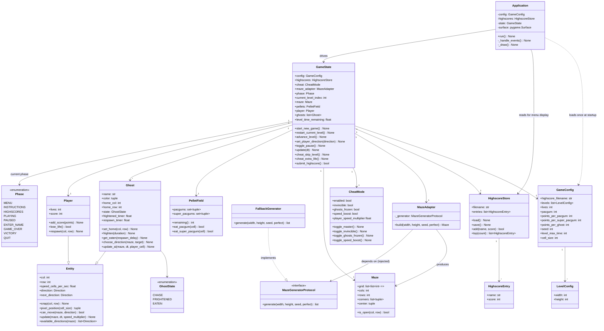
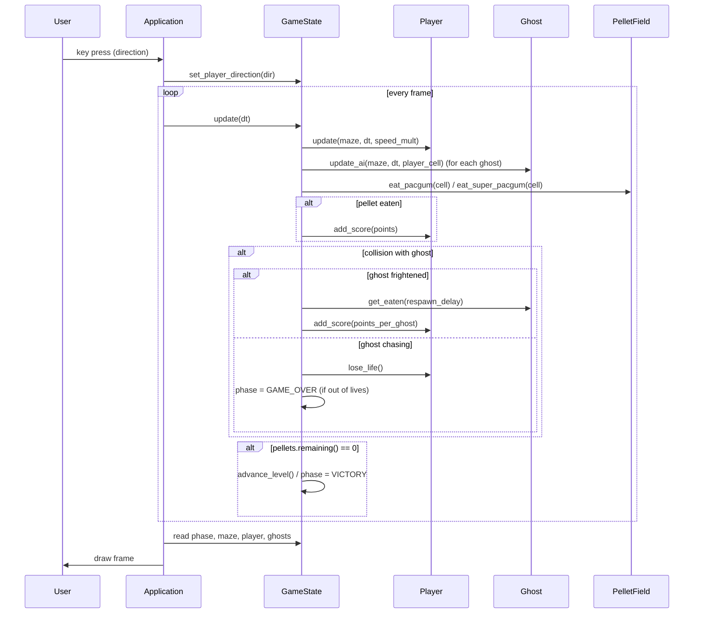

# Architecture

This document describes the class structure, module boundaries, and the
one interface designed for external replacement (the maze generator).
See also the [General Software Architecture](../README.md#general-software-architecture)
summary in the README for the one-paragraph version.

## Layering

```
┌─────────────────────────────────────────────────────────────┐
│  pac-man.py            CLI entry point (arg validation only) │
└───────────────────────────────┬───────────────────────────────┘
                                 │
┌────────────────────────────────▼───────────────────────────────┐
│  src/game/loop.py :: Application                                │
│  pygame init, event loop, input → GameState calls, rendering    │
└───────┬──────────────────────────────────────────────┬──────────┘
        │ reads/renders                                 │ calls
┌───────▼──────────────┐                       ┌─────────▼─────────┐
│  src/ui/              │                       │  src/game/state.py │
│  menu, screens,        │◄──────renders state───│  GameState          │
│  render                │                       │  (single source     │
│                        │                       │   of truth)          │
└────────────────────────┘                       └───┬───────┬───────┬─┘
                                                       │       │       │
                                     ┌──────────────────┘       │       └───────────────┐
                                     │                          │                       │
                          ┌──────────▼─────────┐   ┌────────────▼──────────┐  ┌──────────▼─────────┐
                          │ src/entities/       │   │ src/maze/adapter.py    │  │ src/highscore/      │
                          │ Player, Ghost,       │   │ MazeAdapter            │  │ store.py             │
                          │ PelletField          │   │ (+ pluggable           │  │ HighscoreStore       │
                          │                      │   │  generator)            │  │                      │
                          └──────────────────────┘   └────────────────────────┘  └──────────────────────┘
                                     │
                          ┌──────────▼─────────┐
                          │ src/game/cheat.py   │
                          │ CheatMode           │
                          └─────────────────────┘

                          ┌─────────────────────┐
                          │ src/config/loader.py │  (read once at startup by Application)
                          │ load_config → GameConfig │
                          └─────────────────────┘
```

**Rule of dependency:** `GameState` never imports from `src/ui/` or
`src/game/loop.py`. UI code reads `GameState` and calls its methods; it
never reaches into `Maze`, `Ghost`, or `PelletField` internals directly
except to read plain data for rendering (position, state enum, remaining
pellets). All game rules — scoring, collisions, win/lose, level
progression — live in `GameState` and the entity classes it owns, not in
`Application` or the UI modules.

## Class diagram



## Sequence: one frame while playing



## Interfaces

### `MazeGeneratorProtocol` — the only designed extension point

```python
class MazeGeneratorProtocol(Protocol):
    def generate(self, width: int, height: int, seed: int, perfect: bool) -> list[list[int]]:
        ...
```
main
This is the interface the assigned "A-Maze-ing" package is expected to
satisfy. `MazeAdapter` depends on this interface, not on any concrete
generator:

```python
class MazeAdapter:
    def __init__(self, generator: MazeGeneratorProtocol | None = None) -> None:
        self._generator = generator or FallbackGenerator()

    def build(self, width, height, seed, perfect=False) -> Maze:
        # calls self._generator.generate(...), validates the grid,
        # falls back to FallbackGenerator on any failure
```

`FallbackGenerator` is the only class currently implementing the
protocol (structurally — Python's `Protocol` needs no explicit
inheritance). To wire in a real package: wrap it in a class exposing
`generate(width, height, seed, perfect) -> list[list[int]]` and pass an
instance to `MazeAdapter(generator=...)` in `GameState.__init__`. No
other file needs to change, because everything downstream consumes only
the `Maze` dataclass the adapter returns.

### Implicit interfaces (structural, not `Protocol`-declared)

These aren't formal interfaces in the codebase, but they're the
contracts other classes rely on:

| Contract | Used by | Shape |
|---|---|---|
| `Entity` base | `Player`, `Ghost` | grid position (`col`, `row`), `update(maze, dt, speed_multiplier)`, `pixel_position(cell_size)` for rendering |
| Renderable state | `src/ui/render.py` | reads `GameState.maze`, `.pellets`, `.player`, `.ghosts` — never mutates them |
| `Phase`-driven dispatch | `Application._handle_events` / `._draw` | a dict keyed by `Phase` selects the input handler and the draw function each frame |

## Where each requirement lives

| Subject requirement | Implementation |
|---|---|
| Config file with comments, robust defaults | `src/config/loader.py::load_config` |
| Maze generation via external package | `src/maze/adapter.py::MazeAdapter` + `MazeGeneratorProtocol` |
| Persistent highscore, top 10 | `src/highscore/store.py::HighscoreStore` |
| Cheat mode | `src/game/cheat.py::CheatMode`, wired into `GameState` and `Application` |
| Main menu / game view / game-over UI | `src/ui/menu.py`, `src/ui/screens.py`, `src/ui/render.py` |
| Game loop or state machine | `src/game/state.py::Phase` + `GameState`, driven by `src/game/loop.py::Application` |
