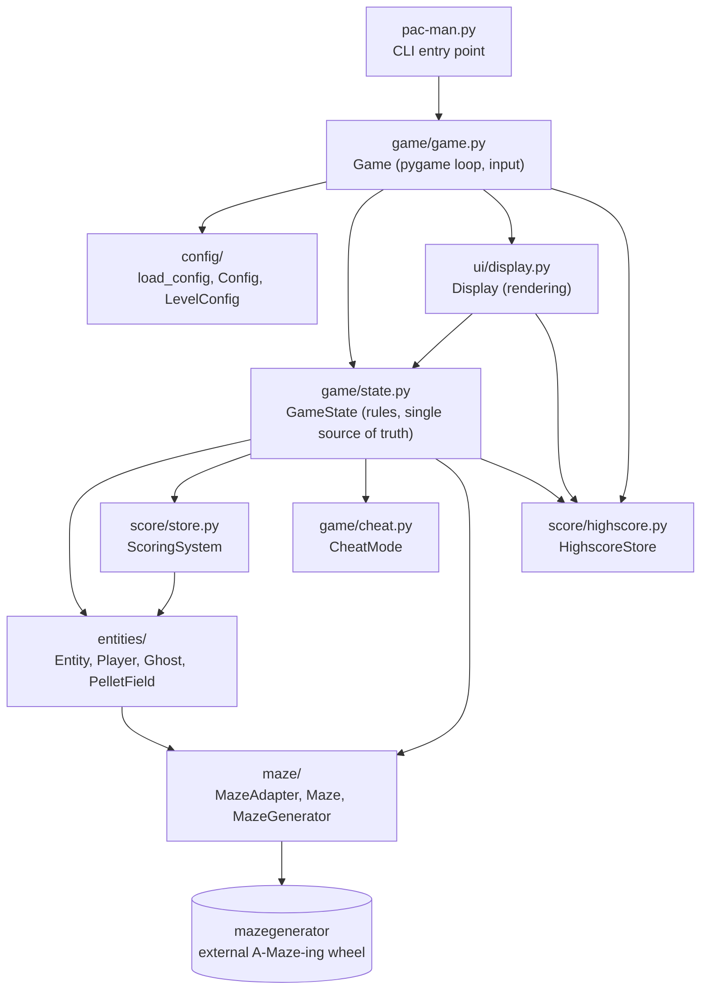
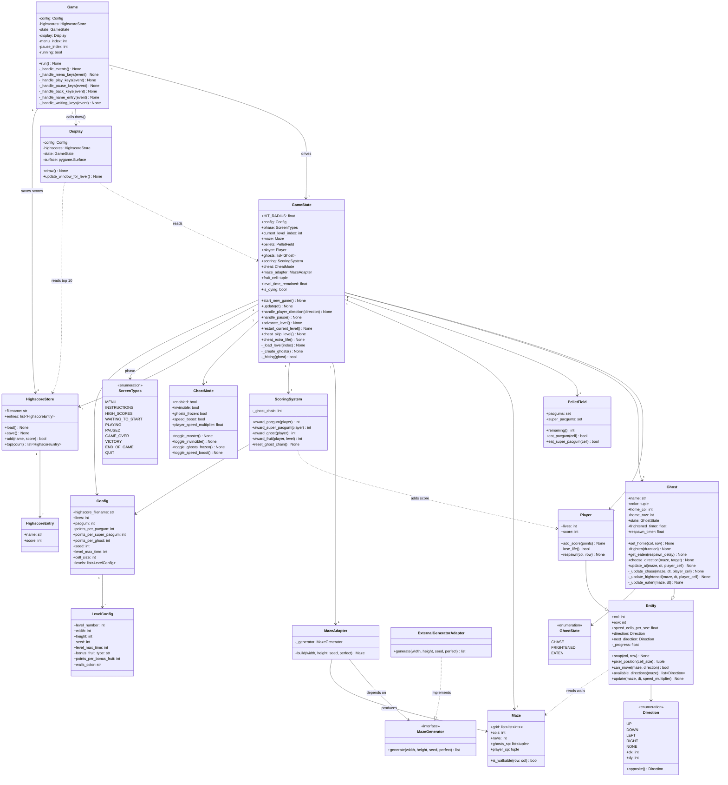
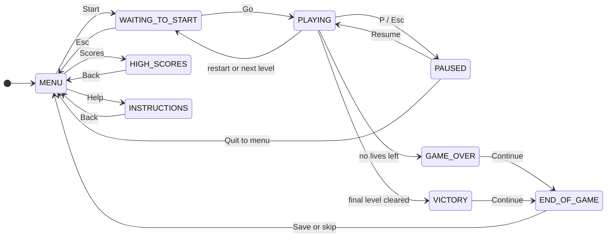
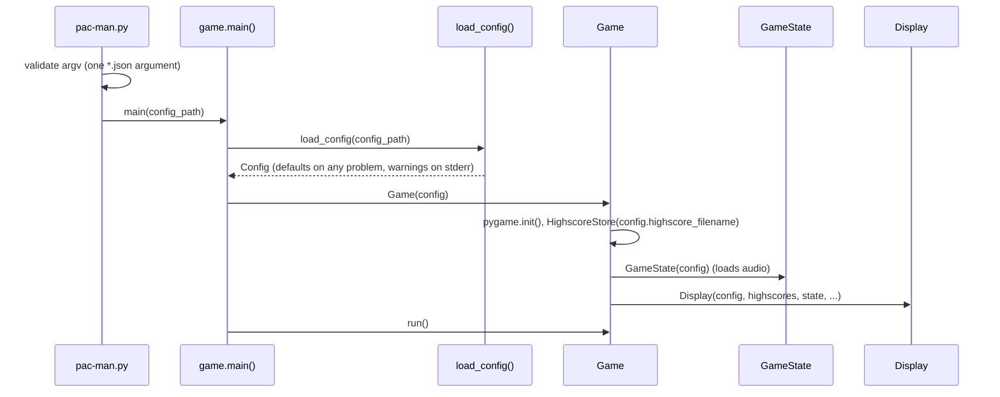
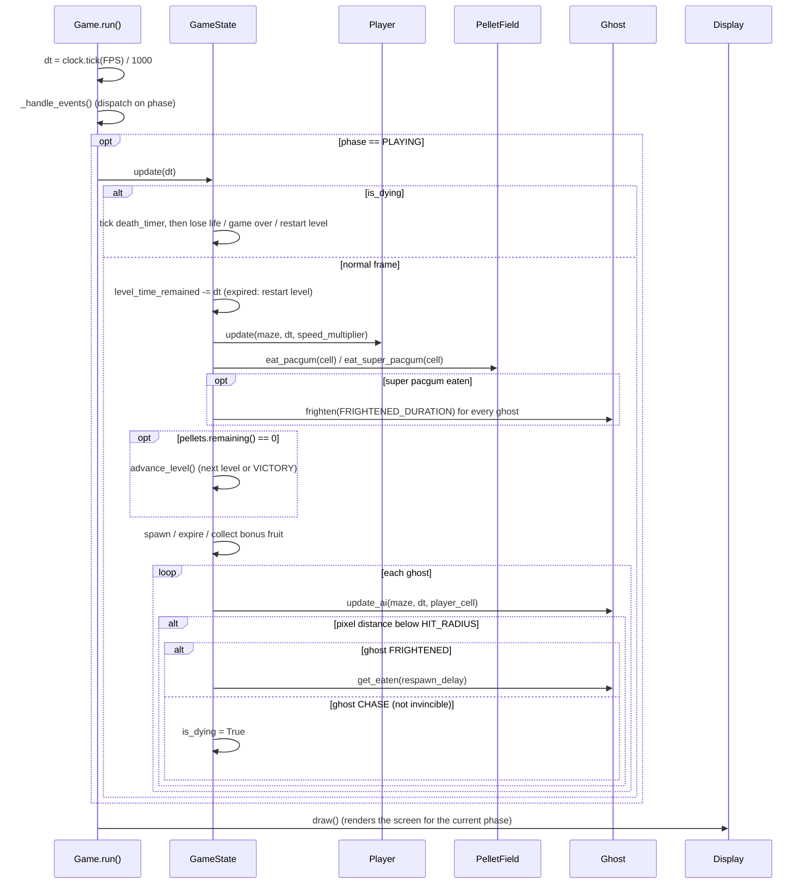
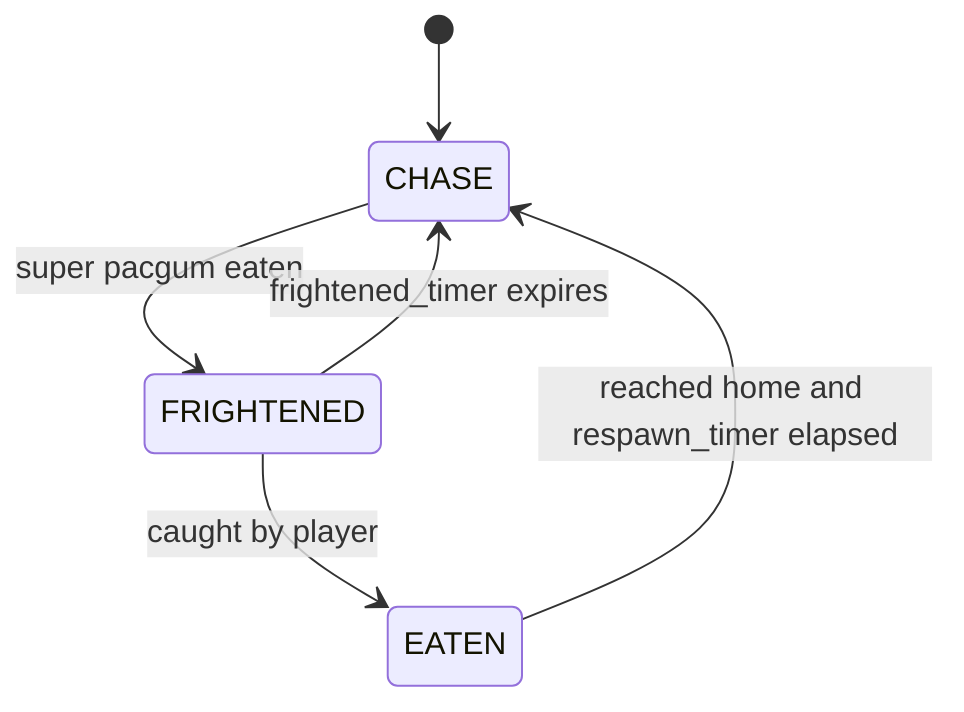

# Architecture

This document describes the module layout, class structure, runtime flow,
and extension points of the project as it exists in the code today. See
also the [General Software Architecture](../README.md#general-software-architecture)
summary in the README for the short version.

## Project layout

```
pac-man.py                      CLI entry point (argument validation only)
config.json                     Default game configuration (commented JSON allowed)
audio/                          Sound effects and menu music (loaded relative to cwd)
src/
  constants.py                  Menu option lists, FRIGHTENED_DURATION
  config/
    config.py                   Config / LevelConfig dataclasses + DEFAULT_CONFIG
    config_loader.py            Comment stripping, validation, load_config()
  game/
    game.py                     Game: pygame loop, input dispatch, music
    state.py                    GameState + ScreenTypes: rules, collisions, levels
    cheat.py                    CheatMode toggles
  entities/
    entity.py                   Direction enum + Entity base (grid movement)
    player.py                   Player(Entity)
    ghost.py                    Ghost(Entity), GhostState, BFS helpers
    palletfield.py              PelletField + build_pellet_field()
  maze/
    maze.py                     Maze dataclass
    maze_generator.py           MazeGenerator Protocol (the extension point)
    maze_adapter.py             MazeAdapter + ExternalGeneratorAdapter
  score/
    store.py                    ScoringSystem (point rules)
    highscore.py                HighscoreStore / HighscoreEntry (JSON persistence)
  ui/
    display.py                  Display: all pygame rendering
  images/                       Ghost / eyes / frightened sprites
tests/
  test_config.py                Config loader behaviour
  test_maze.py                  MazeAdapter / spawn-point behaviour
```

## Layering and dependencies



**Dependency rule:** `GameState` never imports from `src/ui/` or
`src/game/game.py`. `Display` reads `GameState` (phase, maze, pellets,
player, ghosts) and only draws; `Game` is the only place that translates
key presses into `GameState` calls and screen-phase changes. All game
rules (scoring, collisions, level progression, timers) live in
`GameState` and the entity classes it owns.

Two deliberate exceptions to be aware of:

- `GameState` imports `pygame` itself, because it loads and plays the
  sound effects. It is therefore not renderer-free, only UI-free.
- Some screen transitions are performed directly by `Game` (for example
  `self.state.phase = ScreenTypes.MENU`) rather than through a
  `GameState` method.

## Class diagram



## Screen flow (`ScreenTypes`)

`GameState.phase` is the single value that decides which input handler
`Game` runs and which screen `Display` draws.



Notes:

- Start leads to `WAITING_TO_START` (Enter, Space or a move key then begins play).
  `WAITING_TO_START` is also entered after a lost life, an expired level
  timer, or a cleared level.
- `END_OF_GAME` is the name-entry screen: Enter saves the score, Esc skips it.
- `ScreenTypes.QUIT` exists and the main loop checks for it, but nothing
  currently assigns it. The game exits via `Game.running = False`
  instead (Exit menu item, Esc on the menu, or closing the window).
- Losing a life is not instant: `GameState` sets `is_dying` and runs a
  1.2 s death timer during which the world is frozen. Only when the
  timer expires is the life removed and the phase changed.
- When the level timer runs out, `restart_current_level()` is called
  without costing a life.

## Runtime flow

### Startup



### One frame



## Entities and movement

### Grid movement with sub-cell progress

`Entity` is the base class for `Player` and `Ghost`. Position is stored as
an integer cell (`col`, `row`) plus a `_progress` value from 0.0 to 1.0
describing how far the entity is toward the next cell in `direction`.

- `update()` adds `speed_cells_per_sec * speed_multiplier * dt` to
  `_progress`. Each time it reaches 1.0 the entity enters the next cell,
  and then tries `next_direction` (a queued turn) at that cell.
- `can_move()` checks the wall bitmask of the current cell:
  `UP=1, RIGHT=2, DOWN=4, LEFT=8`. A cell value of 15 is a fully walled
  (solid) cell.
- `pixel_position(cell_size)` interpolates between cells for smooth
  rendering.

Because `col`/`row` only change on a full cell crossing, anything that
must look correct on screen compares interpolated positions, not cells.
That is why ghost hits use `GameState._hitting()` (pixel distance below
`HIT_RADIUS` = 0.6 cells), while pellet and fruit pickup stay cell-based.

Speeds: `Player` runs at 6.0 cells/s; ghosts use the `Entity` default of
4.0 cells/s scaled per state (chase 0.7x, frightened 0.9x, eaten 1.8x).

### Ghost AI



| State | Target / behaviour | Decision method |
|---|---|---|
| `CHASE` | All ghosts head for the player's current cell. | On arrival at a new cell, build a BFS distance field to the target and step to a closest neighbour; falls back to `choose_direction` if no path step exists. |
| `FRIGHTENED` | Semi-random flight: 50% random option, 50% option that maximizes squared distance from the player. Never reverses unless it is the only option. `frighten()` also flips the ghost's direction. | `choose_direction`, once per newly entered cell. |
| `EATEN` | Eyes return to the home cell, stop there, and revive into `CHASE` after `respawn_timer`. Cannot be re-frightened meanwhile. | Cached BFS distance field from home, stepping to a strictly closer neighbour. |

Key implementation detail: a ghost only picks a new direction when it
arrives at a cell it has not decided at yet (`_last_decided_cell`), and
assigns `direction` directly. Deciding every frame and only queueing
`next_direction` made turns get validated against the wrong cell when a
crossing happened mid-frame, so ghosts overshot junctions or froze.
`_last_decided_cell` is reset on every state change for the same reason.

`_chase_target()` currently returns the player cell for every ghost, so
the four ghosts differ only in sprite and starting corner.

## Maze generation

`MazeGenerator` (in `maze/maze_generator.py`) is a `typing.Protocol`
describing the one thing the game needs from a generator:

```python
class MazeGenerator(Protocol):
    def generate(self, width: int, height: int, seed: int, perfect: bool) -> list[list[int]]: ...
```

`MazeAdapter` depends on that protocol. By default it uses
`ExternalGeneratorAdapter`, a thin wrapper around the assigned
`mazegenerator` package (installed from the bundled wheel). To use a
different generator, pass any object with a matching `generate()` into
`MazeAdapter(generator=...)`. Everything downstream consumes only the
`Maze` dataclass.

`MazeAdapter.build()`:

1. Calls `generate()` and rejects an empty grid or a grid with no open cell.
2. On any failure it prints an error to stderr and exits with status 1.
   There is no fallback generator.
3. Derives spawn points from the grid with a BFS "nearest open cell"
   search: the four ghosts start near the four corners (inset by one
   cell), the player near the centre.

Levels call `build(..., perfect=False)` so mazes contain loops, which
suits Pac-Man play.

## Configuration

`load_config()` reads the file, strips `#`, `//` and `/* */` comments
outside of strings, parses JSON, and validates each field. Invalid or
missing values produce a warning on stderr and fall back to defaults
from `DEFAULT_CONFIG`; unknown keys are ignored with a warning. Level sizes are
clamped (width 5-40, height 5-30). Per-level `seed` and
`level_max_time` override the global values when present.

## Where each requirement lives

| Subject requirement | Implementation |
|---|---|
| Config file with comments and robust defaults | `src/config/config_loader.py::load_config` |
| Maze generation via the external package | `src/maze/maze_adapter.py::MazeAdapter` + `MazeGenerator` protocol |
| Persistent top-10 highscores | `src/score/highscore.py::HighscoreStore` |
| Cheat mode | `src/game/cheat.py::CheatMode`, keys wired in `Game._handle_play_keys`, effects applied in `GameState.update` |
| Main menu, game view, game-over / victory UI | `src/ui/display.py::Display` |
| Game loop and state machine | `src/game/game.py::Game` + `src/game/state.py::GameState` / `ScreenTypes` |
| Tests | `tests/test_config.py`, `tests/test_maze.py` (`make test`) |

## Known quirks

Behaviour in the current code that is easy to trip over:

- **Two `HighscoreStore` instances.** `Game` creates one from
  `config.highscore_filename` (used for saving and for the highscore
  screen). `GameState` creates its own with a hardcoded
  `"highscores.json"` and only calls `load()` on it. Saving and displaying
  use the configured one, so they agree unless the config names a
  different file.
- **Fruit points ignore config.** `ScoringSystem.award_fruit()` uses a
  hardcoded value per level number; the per-level
  `points_per_bonus_fruit` and `bonus_fruit_type` fields are read by the
  loader but not used for scoring.
- **Duplicate timer attribute.** `GameState` sets both
  `level_time_remaining` (written in `_load_level`, otherwise unused) and
  `level_time_remained` (the one actually used).
- **`ScreenTypes.QUIT` is never assigned**, as noted above.
- **Relative asset paths.** Audio paths (`audio/...`) are relative to the
  working directory, so the game must be started from the project root
  (or the packaged folder).
